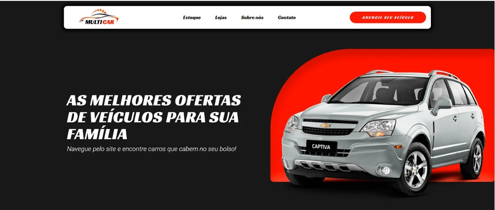

# DESIGN.md: MultiCar (concessionária / revenda de veículos)

## Source
- URL: nenhuma — referência são 4 screenshots locais
- Capture date: 2026-09-23
- Evidence: `base/image.png` (header + hero), `base/image (1).png` (estoque + filtros), `base/image (2).png` (banner "Conheça a nossa empresa"), `base/{56A37092-...}.png` (footer)
- Valores de cor/fonte são **inferidos** a partir das imagens (sem CSS de origem).

## Reference Screenshots

.png)
.png)

## Design Summary
Visual automotivo esportivo: fundo quase preto, vermelho-alaranjado vibrante como única cor de destaque, títulos em caixa alta itálica pesada ("racing"), corpo em sans-serif leve. Header flutuante branco em formato pílula. Hero dividido: texto à esquerda, carro à direita sobre bloco vermelho com canto superior esquerdo muito arredondado. Estoque em fundo claro com cards brancos.

## Design Tokens

### Colors (inferidas)
| Papel | Hex |
|---|---|
| `--bg-dark` fundo principal | `#1a1a1a` |
| `--bg-darker` footer | `#161616` |
| `--red` primária / CTA / preços | `#ff2200` |
| `--red-dark` hover | `#d91c00` |
| `--white` header, cards | `#ffffff` |
| `--light` fundo estoque | `#f1f1f1` |
| `--text-dark` | `#111111` |
| `--text-muted` meta (ano/km) | `#8a8a8a` |
| `--border` | `#e3e3e3` |

### Typography
- Display: **Changa One Italic** (inferida; alternativa: Racing Sans One / Anton italic) — títulos, links do nav, títulos do footer, botão do header. Sempre UPPERCASE, itálico.
- Body: **Roboto** 300/400/500/700.
- Escala: hero h1 `clamp(2rem, 4vw, 3.4rem)` lh 1.1 · h2 seção `2.2rem` · card título `1rem` 700 · corpo `1.05rem` 300 · meta `.75rem`.

### Spacing And Layout
- Container `max-width: 1200px`, gutter 24px.
- Seções: padding vertical 80–120px.
- Raios: header 14px · cards 12px · botões pill 999px · bloco vermelho do hero `border-radius: 220px 0 0 40px`.
- Sombra header: `0 10px 30px rgba(0,0,0,.35)`; cards: `0 4px 18px rgba(0,0,0,.12)`.

## Components
- **Header**: pílula branca flutuante (top 14px), logo à esquerda, nav central (itálico pesado, preto), CTA vermelho pill "ANUNCIE SEU VEÍCULO".
- **Hero**: grid 1fr/1.1fr; h1 branco; subtítulo itálico leve; carro sobre bloco vermelho que sangra para a borda direita.
- **Filtros (sidebar)**: card branco, título "FILTROS:", campo de busca, swatches de cor (bolinhas), radios de marca, select de ordenação, botão vermelho "APLICAR FILTROS".
- **Card de veículo**: imagem 16:10, título UPPERCASE bold, preço vermelho bold, meta cinza (Ano / KM), botão outline vermelho pill "Ver detalhes".
- **Banner Sobre**: foto full-width com overlay escuro ~75%, título display, texto branco leve, botão vermelho "Saber Mais".
- **Footer**: 3 colunas (logo + redes; Links rápidos com ✓ vermelho; Contatos com ícones vermelhos), linha divisória vermelha, copyright itálico bold uppercase centralizado.

## Page Patterns
Header → Hero → Estoque (sidebar + grid) → Sobre (banner) → Footer. Mobile: nav vira menu hambúrguer, hero empilha, sidebar acima da grid, grid 1 coluna.

## Content Style
PT-BR, direto e comercial. Títulos curtos em caixa alta ("AS MELHORES OFERTAS…", "CARROS DISPONÍVEIS:"). CTAs imperativos ("Anuncie seu veículo", "Saber Mais", "Ver detalhes").

## Agent Build Instructions
HTML/CSS/JS estático. Tokens em `:root`. Fontes via Google Fonts. Estoque renderizado de array JS com filtro por busca, cor, marca e ordenação. "Ver detalhes" abre WhatsApp com o nome do carro.

## Rerun Inputs
workflow: firecrawl-website-design-clone (adaptado: screenshots locais)
source_url: n/a
target_stack: HTML + CSS + JS estático
output: DESIGN.md + index.html
